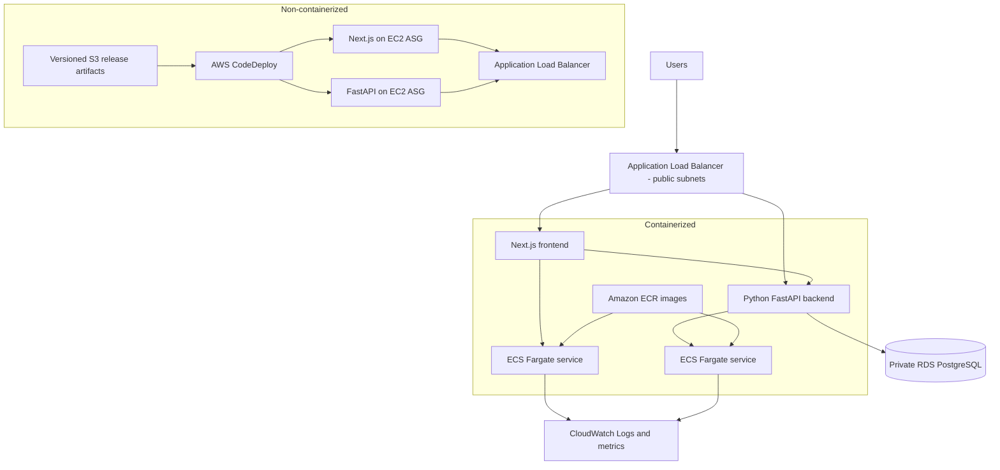

# Architecture

## High-level diagram

## Containerized path

Internet → ALB in two public subnets → ECS Fargate services in private subnets. `/api/*`, `/health`, and `/db-health` route to the Python service; other paths route to Next.js. Images are stored in ECR and tagged with the Git commit SHA. RDS PostgreSQL is private and accepts port 5432 only from the application security group. CloudWatch Logs retain application logs for 30 days. ECS Container Insights is enabled.

## Non-containerized path

Internet → ALB in public subnets → separate frontend and backend EC2 Auto Scaling Groups in private subnets. Next.js listens on 3000 and FastAPI on 8000. The launch templates install the CodeDeploy agent; application artifacts are uploaded to a versioned S3 key and released by CodeDeploy. RDS PostgreSQL remains private. Configure CodeDeploy application/deployment groups with EC2 tag filters `Component=frontend` and `Component=backend`, and `Environment=<environment>`.

## Environments

Use separate stacks and preferably separate AWS accounts for `dev`, `staging`, and `prod`. Reuse templates with parameters. Use protected GitHub Environments and approvals for staging/production. Keep image/artifact versions immutable and promote the same tested commit.

## Production hardening before public launch

- Provide an ACM certificate and enforce HTTPS; redirect HTTP to HTTPS after validating listener rules.
- Create VPC endpoints or NAT routing for private workload egress. Two NAT gateways are configured for AZ resilience but incur hourly/data charges.
- Configure RDS Multi-AZ in production, backup retention and point-in-time recovery.
- Add WAF, CloudWatch alarms, dashboards, SNS notifications, and tested DR.
- Add ECS service autoscaling and EC2 ASG scaling policies based on CPU/request metrics.
- Confirm database migration strategy and run migrations as a controlled release step.
